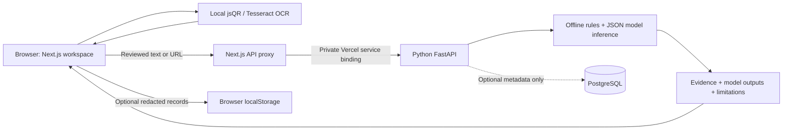

# PhishGuardX

[Live website](https://phishguardx-pi.vercel.app) · [GitHub repository](https://github.com/aashleshshet/PhishGuardX)

**Clarity before you click.** A multimodal phishing-analysis workspace with an Apple-inspired liquid-glass interface, self-hosted Google Sans, light/dark themes, and evidence-first explanations.

A working, research-oriented baseline—not an antivirus product or a guarantee of safety. Real trained models run on every analysis; sample inputs are explicitly labeled.

## What works

- **Email:** connect Google or Microsoft through Clerk with explicit read-only consent, choose one recent message, or paste text/upload `.eml`; inspect pressure tactics, sensitive-information requests, extracted links, sender/reply-domain differences, and reported SPF/DKIM/DMARC results.
- **URLs:** independent OpenPhish.eu API and OpenPhish.com local feed, optional PhishTank/Google Safe Browsing/URLhaus, plus offline lexical classification, actual domain parsing, Punycode, brand-name misuse, userinfo deception, private IPs, shortening and suspicious redirect parameters. Submitted destinations are never retrieved.
- **QR codes:** decode PNG/JPEG/WebP locally, inspect the destination, and analyze without opening it.
- **Screenshots:** self-hosted Tesseract OCR runs inside the browser; review extracted text before submitting it for analysis.
- **Explanations:** supporting evidence, highlighted text, model contributions, explicit unavailable checks, and practical recommendations.
- **Accounts:** Clerk sign-in, real user name/avatar, profile management, and separate local history per account.
- **Workspace:** dashboard, all four analyzers, an evidence-based security assistant, searchable history, education, evaluation reports, JSON exports, and privacy settings.
- **Privacy:** no external AI calls; raw text is processed in memory; live URL checks send the URL to enabled providers with an opt-out; optional browser history is redacted. Optional PostgreSQL stores only anonymous scan metadata.
- **Optional extension:** Chrome Manifest V3, explicit URL submission, `activeTab` permission only; no page-content or background-history collection.

## Stack

Next.js 16 · React 19 · TypeScript · Tailwind CSS 4 · shadcn-style Radix/CVA primitives · Framer Motion · FastAPI · scikit-learn training · portable JSON inference · PostgreSQL integration · jsQR · Tesseract.js.

Training uses interpretable TF-IDF logistic regression with a Naive Bayes comparator and separate probability calibration. XGBoost, Transformers, a generative LLM, and visual brand classification are not used in this baseline.

## Run locally

Requirements: Node.js 22+, Python 3.12 recommended (core code/tests also work on 3.9), npm.

```sh
npm ci --prefix frontend
python3 -m venv .venv
.venv/bin/pip install -r backend/requirements-dev.txt
.venv/bin/python -m uvicorn backend.app:app --host 127.0.0.1 --port 8000
```

In another terminal:

```sh
npm run dev
```

Open [localhost:3000](http://localhost:3000). FastAPI's interactive API documentation is at [localhost:8000/docs](http://localhost:8000/docs). Trained JSON models are committed, so training is not required to run the app. Offline analysis works without API keys. To enable the anonymous URL API locally, start the backend with `OPENPHISH_API_ENABLED=true .venv/bin/python -m uvicorn backend.app:app --host 127.0.0.1 --port 8000`. Configure feed storage and synchronization separately as documented in [OpenPhish setup](docs/OPENPHISH.md). For accounts and mailbox imports, configure Clerk as described in [account setup](docs/ACCOUNTS.md).

## Verify

```sh
npm run check
npm test --prefix frontend
npm run build
.venv/bin/python -m pytest backend/tests -q
```

The backend suite covers malformed URLs, domain deception, forbidden network access, headers, MIME parsing, input limits, privacy, screenshot limitations, and numerical parity with the training runtime. The production build uses Webpack for deterministic compatibility with constrained local environments.

## Measured evaluation

| Model | Held-out examples | Precision | Recall | F1 | False positives | False negatives |
| --- | ---: | ---: | ---: | ---: | ---: | ---: |
| URL lexical phishing classifier | 12,377 | 93.03% | 81.72% | 87.01% | 331 | 988 |
| Historical email spam classifier | 896 | 95.51% | 99.72% | 97.57% | 17 | 1 |

These are historical dataset measurements, not prospective production performance. Email **spam** probabilities are not phishing probabilities. URL train/validation/calibration/test groups are separated by registered domain; email groups use normalized message fingerprints. Both corpora contain biases and old campaigns. See [model cards](docs/MODELS.md), [dataset documentation](docs/DATASETS.md), and [machine-readable results](backend/models/evaluation.json).

```sh
.venv/bin/pip install -r ml/requirements.txt
.venv/bin/python ml/train.py
```

The pipeline downloads fixed public archives, records their SHA-256 hashes, cleans and deduplicates inputs, samples URL data with seed 42, splits groups, fits preprocessing on training data only, compares two classifiers, calibrates on a separate split, selects thresholds on validation, and evaluates once on held-out test data. Raw datasets remain gitignored.

## Architecture



Vercel Services deploys the frontend and private Python backend together in one project. Services is currently a Vercel beta feature. The backend has no public ingress rule; Next.js exposes a small allowlist of API operations. See [deployment guide](docs/DEPLOYMENT.md).

## Docker with PostgreSQL

Copy `.env.example` to `.env`, set a strong development password, then:

```sh
docker compose up --build
```

This starts Next.js, FastAPI, and PostgreSQL; the database schema initializes on the first run. Cloud metadata sync remains off until enabled in Settings. Existing database volumes require explicit migrations. Docker configuration is supplied; see the verification record for what was actually executed.

## Deliberate limits

Live reputation is independently configurable; the dashboard shows actual availability, errors, rate limits, and feed freshness. No WHOIS/domain age, DNS queries, redirect expansion, active crawling, or visual logo verification is performed. Imported authentication headers are untrusted and are not cryptographically verified. The assistant is a curated, evidence-grounded explainer, not a general-purpose LLM. OCR is English-first and can misread text. Clerk provides accounts; local history does not sync across devices. Mailbox connections need custom Google/Microsoft OAuth credentials configured in Clerk. Hosted PostgreSQL must be configured separately; the default deployment uses local history.

Before a high-traffic release, add durable rate limits, abuse monitoring, authenticated database ownership, retention jobs, stronger campaign/temporal evaluation, and provider quota monitoring. Read [responsible use](docs/RESPONSIBLE_USE.md) and [API documentation](docs/API.md).

## Repository map

- `frontend/` — interface, local image processing, and API proxy.
- `backend/` — FastAPI, inference, trained artifacts, SQL schema, tests.
- `ml/` — reproducible training and dataset acquisition.
- `extension/` — optional unpacked Chrome extension.
- `docs/` — deployment, datasets, models, privacy, and verification notes.

Code is MIT licensed. Dataset, font, and OCR licenses remain separate; see [third-party notices](docs/THIRD_PARTY.md).

## Threat intelligence

See [OpenPhish integration](docs/OPENPHISH.md) for independent provider setup, verified schemas, feed licensing, persistent storage, daily hosted scheduling, cache and quota behavior, and mocked tests. Confirmed phishing records raise the scan to high risk. An absent record never means safe.
